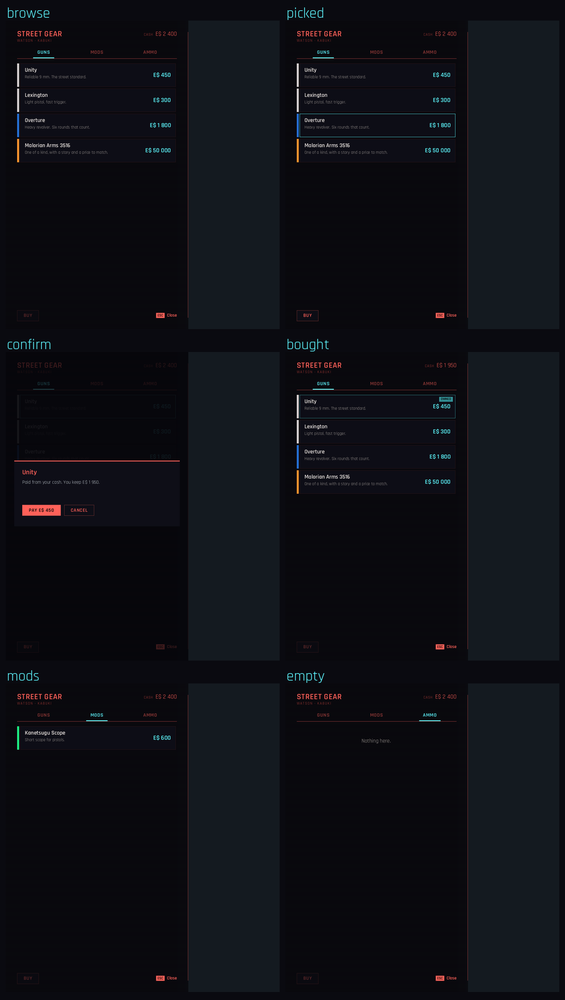

# open77-nui-kit

Offline tools for [Open77](https://open2077.net) NativeUI screens: RmlUi documents (RML + RCSS) driven from client
Lua. See what a screen really does before you start the game.

- **`rml-check`** loads your document in real RmlUi for every state you describe and fails on anything RmlUi
  complains about: a binding to a model field that doesn't exist, an unknown property or value, broken XML, a
  `data-for` over a non-array, a button whose click calls nothing or the wrong event.
- **`rml-preview`** lays the document out in real RmlUi with your real fonts and paints a PNG per state (boxes,
  borders, gradients, images, masks, vector paths, text) over a backdrop. Real sizes, wrapping, clipping, overflow.
- **`lrbind`** runs RmlUi's data bindings inside a WebUI page, so one markup serves a WebUI page and its NativeUI
  twin; its behaviour is measured against real RmlUi case by case (`bin/lrbind-parity`).
- **`fake-nui`** is a fake `Open77.ui` for plain `lua5.4`: run your screen's client Lua offline, click through it,
  and write the states out as cases for the two tools above.



The kit shows layout and bindings. It does **not** show what Open77 adds on top of RmlUi 6.3 (glow, chromatic and
scanline filters, `fx()` decorators, `<shape>` paint, motion channels, `<scene3d>`), hover states, or the game's
anti-aliasing. Check those in the game with `nui.hotreload on`.

## Quick start

Needs `git`, `g++` (C++17), `python3` with Pillow for previews, `lua5.4` for fake-nui, `node` 18+ for lrbind.

```sh
git clone <this repo> && cd open77-nui-kit
scripts/build.sh                            # fetches RmlUi 6.3 and builds the host once (about a minute)
cd examples/side-menu
lua5.4 models.lua > cases.json              # the client Lua, run on fake-nui, writes one case per state
../../bin/rml-check ui/menu.rml cases.json
../../bin/rml-preview ui/menu.rml cases.json --font kitraj=fonts/Rajdhani-Regular.ttf,fonts/Rajdhani-SemiBold.ttf --out out
```

`out/` now holds `browse.png`, `confirm.png`, ... and `sheet.png`. The example's README walks through what each file
does and the bug the preview caught while it was written.

## The loop for your own screen

1. Write `ui/<screen>.rml` + `.rcss`. Start the sheet with `div { display: block; box-sizing: border-box; }`
   (RmlUi has no default stylesheet; see [docs/rmlui-traps.md](docs/rmlui-traps.md)).
2. Describe its states as cases: a JSON array of `{ name, model, clicks?, events? }`
   ([docs/cases.md](docs/cases.md)). Hand-write them, or generate them from your client Lua with fake-nui so the
   models are exactly what the client builds.
3. `rml-check ui/<screen>.rml cases.json` in your test run. It exits 1 on any problem.
4. `rml-preview ui/<screen>.rml cases.json --font <family>=<ttf>... --bg <a game screenshot>` while you design.
   `--compare <folder of mockup shots>` puts your mockup next to each state.
5. In the game: `nui.hotreload on`, then look at the effects the kit can't show.

## What's in the repo

| Path | What |
|---|---|
| `bin/rml-check`, `bin/rml-preview` | the two CLIs (Python 3; preview needs Pillow) |
| `bin/lrbind-parity`, `bin/lrbind-sync` | lrbind's parity runner and the copy helper for resources |
| `host/` | `rmlhost`: real RmlUi with a JSON-fed dynamic data model; modes `check`, `layout`, `parity` |
| `scripts/build.sh` | builds RmlUi (pinned tag, no CMake, no FreeType) and the host into a cache dir |
| `lrbind/` | `lrbind.js`, `lrbind.lua`, their tests and the parity suite ([lrbind/README.md](lrbind/README.md)) |
| `fake-nui/fake_nui.lua` | fake `Open77.ui`, a coroutine scheduler for `CreateThread`/`Wait`, an instruction counter, JSON out |
| `examples/side-menu/` | a complete small screen: document, sheet, client Lua, offline driver, fonts |
| `docs/` | the case format and the RmlUi traps every native document meets |

The RmlUi checkout and build live in `${XDG_CACHE_HOME:-~/.cache}/open77-nui-kit/` (override with
`NUIKIT_RMLUI_DIR`); nothing is vendored. `scripts/test.sh` runs the kit's own tests.

## License

MIT ([LICENSE](LICENSE)). lrbind.js ports parts of RmlUi (MIT); the notice is in [NOTICE](NOTICE). The example's
font is Rajdhani under the SIL OFL. Not affiliated with the Open2077 project.
