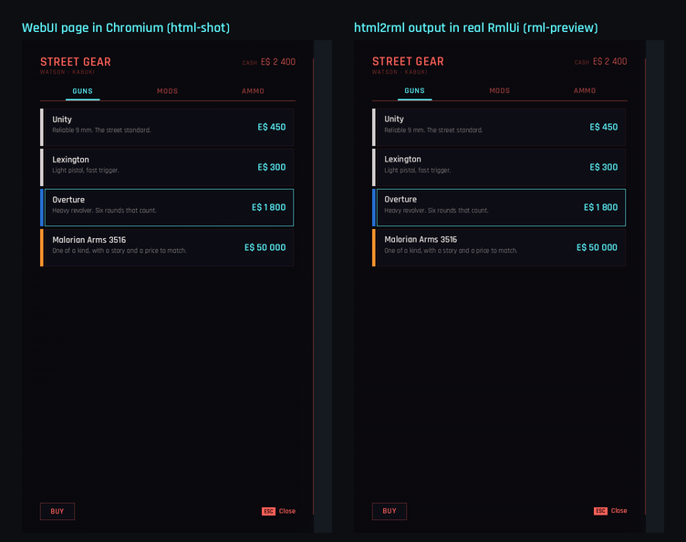

# open77-nui-kit

See what an [Open77](https://open2077.net) NativeUI screen really does before you start the game.

NativeUI screens are RmlUi documents (RML + RCSS) driven from client Lua. RmlUi is not a browser: no devtools, no
default stylesheet, its own CSS dialect, and a typo in a binding fails silently in the game. Without the kit, every
fix costs a reload in the game. The kit runs the real RmlUi 6.3 offline, so a wrong binding fails in your test run and
a layout bug shows up in a PNG.

What you can do with it:

- **Build a native screen and check it offline.** Every state you describe is loaded in real RmlUi; bindings,
  properties, images, events and clicks are checked, and each state is painted to a PNG with your real fonts.
  [Workflow A](#workflow-a-write-the-native-screen).
- **Port a WebUI page to NativeUI.** `html2rml` converts the HTML + CSS into RML + RCSS and reports everything it
  could not map, with `file:line` and what to do instead; `html-shot` + `rml-preview --compare` put the page and
  its native twin side by side, state by state. [Workflow B](#workflow-b-start-from-a-webui-page),
  [what converts](docs/converter.md).
- **Keep one markup for both surfaces.** lrbind runs RmlUi's data bindings in a WebUI page and gives client Lua
  one API for both, its behaviour measured case by case against real RmlUi. [lrbind](lrbind/README.md).
- **Run your client Lua without the game.** fake-nui is a fake `Open77.ui` for plain Lua 5.4, with Open77's
  scheduler and instruction budget: click through a screen and write its states out as cases.
  [The case format](docs/cases.md).
- **Gate it in CI.** `rml-check` exits 1 on any problem; `--strict` does the same for the preview's missing and
  unpainted notes and for the converter's report; `lrbind-sync check` fails on a stale copy of lrbind.
  [Using it in your resources](#using-it-in-your-resources).
- **Hand it to an agent.** The kit ships an [Agent Skills](https://agentskills.io) skill for Claude Code, Codex,
  Hermes and other agents: the loops, what "done" means, the RmlUi traps, and how to read every line the tools
  print. Agents changing the kit itself get [AGENTS.md](AGENTS.md). [Agents](#agents).
- **Avoid the RmlUi traps** every native document meets, each with its reason: [docs/rmlui-traps.md](docs/rmlui-traps.md).



## The tools

| Tool | Answers | Needs |
|---|---|---|
| `rml-check` | Does the document load cleanly in every state, and does every button fire the right event? | a C++ compiler |
| `rml-preview` | What does each state look like with my real fonts, sizes and wrapping? | a C++ compiler, Pillow |
| `fake-nui` | What models does my client Lua actually build? Run it in plain Lua and write the states out as cases. | Lua 5.4 |
| `html2rml` | I have a WebUI page. What is its NativeUI twin, and what can't be converted? | Python |
| `lrbind` | Can one markup serve a WebUI page and its NativeUI twin? Yes: RmlUi's data bindings, run in the browser. | (none) |
| `html-shot` | What does the WebUI page look like per state, to compare with the preview? | Chromium |

`rml-check` exits 1 on anything RmlUi complains about: a binding to a field the model lacks, an unknown property or
value (Open77's own properties, filters and `fx()` included), broken XML, a missing image, an event the client does
not declare, or a click (a real press at the button's centre) that calls nothing, the wrong event or the wrong
arguments:

```text
cases: 6  clicks ok: 4  model: menu  outline: /tmp/rml-check-x0r71nb0.outline.txt
CLICK FAIL browse: #list .row -> the case's "events" do not list 'pik'
rml-check: FAIL
```

## Quick start

Runs on Linux, macOS and Windows. Needs `git`, a C++17 compiler, Python 3.8+, Lua 5.4 and, for lrbind's tests,
Node 20.19+ (22 in CI). Optional: Pillow for previews, a Chromium for `html-shot`.

| | C++17 compiler | Lua 5.4 (as in the game: `lua -v` says) | Pillow |
|---|---|---|---|
| Debian / Ubuntu | `apt install g++` | `apt install lua5.4` | `apt install python3-pil` |
| Fedora | `dnf install gcc-c++` | `dnf install lua` (command `lua`) | `dnf install python3-pillow` |
| Arch | `pacman -S gcc` | `pacman -S lua54` (Arch's `lua` is 5.5) | `pacman -S python-pillow` |
| macOS | `xcode-select --install` | `brew install lua@5.4`, then put `$(brew --prefix lua@5.4)/bin` on PATH (Homebrew's `lua` is 5.5) | `pip3 install Pillow` |
| Windows | Visual Studio or its Build Tools with the C++ workload (found by itself), or MinGW-w64: `winget install BrechtSanders.WinLibs.POSIX.UCRT` | `winget install DEVCOM.Lua` | `py -m pip install Pillow` |

A Chromium for `html-shot`, on any OS: `npx playwright install chromium-headless-shell`, or `NUIKIT_CHROME=/path/to/chrome`.
The build takes the compiler in `CXX` when set, else the first it finds ([Settings](#settings)).

The commands below say `lua5.4`; where the binary is called `lua`, use that (`scripts/test.sh` finds either, or `LUA=...`).

```sh
git clone https://github.com/glitchbunny0/open77-nui-kit && cd open77-nui-kit
scripts/build.sh                            # fetches RmlUi 6.3 and builds the host once (about a minute)
cd examples/side-menu
lua5.4 models.lua > cases.json              # the client Lua, run on fake-nui, writes one case per state
../../bin/rml-check ui/menu.rml cases.json
../../bin/rml-preview ui/menu.rml cases.json --font kitraj=fonts/Rajdhani-Regular.ttf,fonts/Rajdhani-SemiBold.ttf --out out
```

On Windows, Git Bash runs these commands as they are (given a `python3`). From PowerShell or cmd, clone as above and
start each tool through Python:

```powershell
cd open77-nui-kit
py scripts\build.py
cd examples\side-menu
lua models.lua > cases.json
py ..\..\bin\rml-check ui\menu.rml cases.json
py ..\..\bin\rml-preview ui\menu.rml cases.json --font kitraj=fonts\Rajdhani-Regular.ttf,fonts\Rajdhani-SemiBold.ttf --out out
```

`out/` now holds one PNG per state and `sheet.png`. [The example's README](examples/side-menu/README.md) walks
through each file and the bug the preview caught while it was written.

## Workflow A: write the native screen

1. Write `ui/<screen>.rml` + `.rcss`. Start the sheet with `div { display: block; box-sizing: border-box; }`:
   RmlUi has no default stylesheet ([docs/rmlui-traps.md](docs/rmlui-traps.md)).
2. Describe its states as cases, a JSON array of `{ name, model, clicks?, events? }` ([docs/cases.md](docs/cases.md)).
   Write them by hand, or let fake-nui run your client Lua so the models are exactly what the client builds.
3. Put `rml-check ui/<screen>.rml cases.json` in your test run.
4. While you design: `rml-preview ... --font <family>=<ttf>... --bg <a game screenshot>`; `--compare <folder>` puts a
   mockup next to each state.
5. In the game, `nui.hotreload on` for what the kit can't show (below).

## Workflow B: start from a WebUI page

Run from the resource's folder (the one with `web/`). `--out` takes a folder of its own, because html2rml overwrites
what it finds there; never point it at a hand-written `ui/`.

```sh
cd examples/side-menu
../../bin/html2rml web/index.html --out out/twin --name menu     # out/twin/menu.rml + .rcss + menu.report.md
../../bin/rml-check out/twin/menu.rml cases.json
../../bin/html-shot web/index.html cases.json --out shots         # optional: needs a Chromium; fails when the bindings did not run
../../bin/rml-preview out/twin/menu.rml cases.json --font kitraj=fonts/Rajdhani-Regular.ttf,fonts/Rajdhani-SemiBold.ttf --out out/twin-preview --compare shots
```

The report lists the scripts to port to client Lua (with the ids, classes and styles each one touches), the
`Open77.ui.loadFont` calls the client needs, and every rule, value and element RmlUi has no form for, with file:line.
Pass every font weight the sheet uses to `--font`, comma-separated. [docs/converter.md](docs/converter.md) has the
full mapping and the RmlUi facts behind it, each measured in real RmlUi.

## Using it in your resources

- **Pin a tag.** Vendor a tagged release into your tree (`git archive vX.Y.Z`) or add it as a submodule, and update
  on purpose. The tools only need the kit's folder; the RmlUi build lives in a cache, not in your tree.
- **lrbind copies.** A resource ships its own `web/lrbind.js` / `client/lrbind.lua`.
  `bin/lrbind-sync add <resource>` writes them, `refresh <folder>` brings old copies up to date after an update, and
  `check <folder>` (exit 1) belongs in your test run.
- **One wrapper per screen.** A small script that builds the cases and calls `rml-check` gives your test runner
  one line per document.

## What the kit can't tell you

It shows layout and bindings. It does **not** show what Open77 adds on top of RmlUi 6.3 when drawing (the glow,
chromatic and scanline filters, `fx()` decorators, `<shape>` paint, motion channels, `<scene3d>`), hover states,
or the game's anti-aliasing. `rml-check` validates those values; only the game shows them. `rml-preview` lists
what it didn't paint per state (`NOT PAINTED ...`, missing images and faces), and `--strict` makes that a failure.

## Settings

| Variable | Default | Effect |
|---|---|---|
| `NUIKIT_RMLUI_DIR` | `${XDG_CACHE_HOME:-~/.cache}/open77-nui-kit/rmlui-6.3`; Windows: `%LOCALAPPDATA%\open77-nui-kit\rmlui-6.3` | where RmlUi is cloned and the host built |
| `CXX` | the first found: `g++`, `clang++`, `c++`; Windows: `cl` on PATH, `g++`, `clang++`, then Visual Studio by vswhere | the C++17 compiler (`g++`, `clang++`, `cl` or `clang-cl`, by name or path); RmlUi's objects and the host are built once per compiler |
| `NUIKIT_HOST` | (built on demand) | use this already built `rmlhost` |
| `NUIKIT_CHROME` | Playwright's headless shell | the Chromium `html-shot` starts |
| `LUA` | `lua5.4`, then `lua`, then `lua54` | the Lua 5.4 `scripts/test.sh` runs |
| `NUIKIT_REQUIRE_CHROME`, `NUIKIT_REQUIRE_PILLOW` | unset | `1`: a missing Chromium / Pillow fails the test run instead of skipping (CI sets both) |

## Agents

The kit ships an [Agent Skills](https://agentskills.io) skill for agents that build screens with it:
[skills/open77-nativeui/](skills/open77-nativeui/SKILL.md) (the loop, the traps, how to read every line the tools
print, porting a WebUI page). Link it into the project the agent works in, so it follows the kit version you pin:

```text
ln -s <kit>/skills/open77-nativeui .claude/skills/open77-nativeui      # Claude Code
ln -s <kit>/skills/open77-nativeui .agents/skills/open77-nativeui      # Codex and other Agent Skills readers
```

On Windows a junction needs no admin rights: `mklink /J .claude\skills\open77-nativeui <kit>\skills\open77-nativeui`.

Agents changing the kit itself: [AGENTS.md](AGENTS.md).

## Developing the kit

`scripts/test.sh` runs every suite, one `tests/<area>.sh` per area. Every check is proven by a mutant: a copy of the
tool with one planted bug that must turn exactly that check red ([tests/README.md](tests/README.md)). CI runs it on
Linux, macOS and Windows (MSVC and MinGW-w64); on Windows it runs in Git Bash, with a `python3` on PATH. The repo map
and the rules for changes are in [AGENTS.md](AGENTS.md).

## License

MIT ([LICENSE](LICENSE)). lrbind.js ports parts of RmlUi (MIT); the notice is in [NOTICE](NOTICE). The example's
font is Rajdhani under the SIL OFL. Not affiliated with the Open2077 project or with CD PROJEKT; the example's item
names come from Cyberpunk 2077, a trademark of CD PROJEKT S.A.
