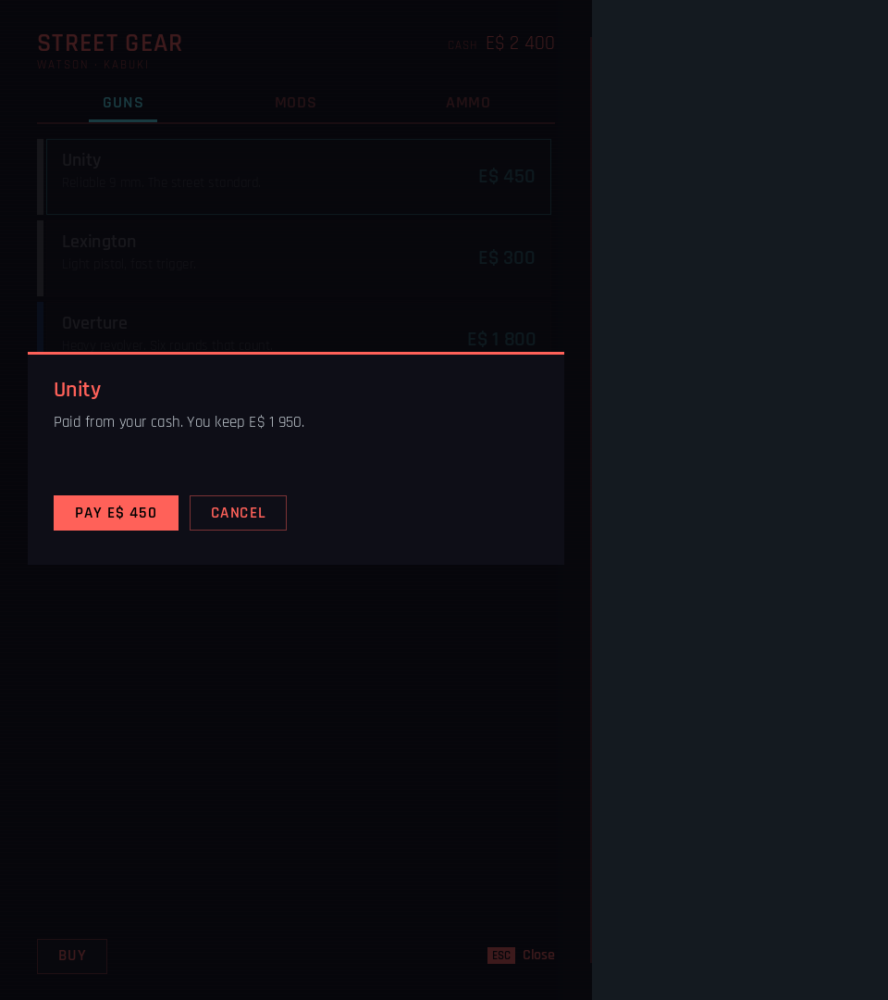

# Example: a side menu

A small but complete NativeUI screen: a 640 dp panel pinned to the left edge, tabs, a list of items, a buy button and
a confirm dialog inside the panel. Everything the kit does, on one screen.

| File | What |
|---|---|
| `ui/menu.rml` | the document: markup with RmlUi data bindings (`{{x}}`, `data-for`, `data-if`, `data-class-*`, `data-event-click`) |
| `ui/menu.rcss` | its sheet |
| `client/menu.lua` | the client half: `Menu.open(shop, cash)` creates the document, fills the `menu` model, answers the events |
| `models.lua` | runs `client/menu.lua` on the kit's fake `Open77.ui`, clicks through it like a player, prints one case per state |
| `fonts/` | Rajdhani (SIL OFL, `fonts/OFL.txt`) |
| `web/index.html`, `web/app.css` | the WebUI twin: the same markup and bindings as a browser page (lrbind.js), styled the way a web page is written (px, `:root` variables, `calc()`, `rgba()`, shorthands) |

```sh
lua5.4 models.lua > cases.json
../../bin/rml-check ui/menu.rml cases.json
../../bin/rml-preview ui/menu.rml cases.json --font kitraj=fonts/Rajdhani-Regular.ttf,fonts/Rajdhani-SemiBold.ttf --out out
```

The sheet names the font `KitRaj`; RmlUi keeps family names lower-case, hence `kitraj=` on the command line. In the
game the client would call `Open77.ui.loadFont("fonts/Rajdhani-Regular.ttf", "KitRaj")` per weight before creating
the document, and list `ui/*` and `fonts/*` in the manifest's `files`.

## The WebUI twin

`web/` is the same screen as a browser page. `bin/html2rml` turns it into an RmlUi document + sheet that pass
`rml-check` with the same cases, and whose layout is pixel-identical to the hand-written `ui/menu.rml` + `menu.rcss` in
all six states (`scripts/test.sh` checks both). `bin/html-shot` shoots the page per case with the case's models, so the
browser and the converted document can sit side by side:

```sh
../../bin/html2rml web/index.html --out out/twin --name menu      # + out/twin/menu.report.md: 3 items (lrbind.js, 2 fonts)
../../bin/rml-check out/twin/menu.rml cases.json
../../bin/html-shot web/index.html cases.json --out out/shots      # needs Chromium (see docs/converter.md)
../../bin/rml-preview out/twin/menu.rml cases.json --font kitraj=fonts/Rajdhani-Regular.ttf,fonts/Rajdhani-SemiBold.ttf \
    --out out/twin-preview --compare out/shots --sheet-crop 0,0,660,1080
```

**What the preview caught while this was written:** the first sheet had `.tab .bar { position: absolute; ... }` with
no `position: relative` on `.tab`, so every tab's underline sat at the same spot under the middle tab, whichever tab
was active. `rml-check` was clean (it's valid RCSS); the preview showed it at once.

**Try breaking it:** rename `{{r.price}}` to `{{r.prise}}` in `ui/menu.rml`, or point the buy button at `buy2()`, and
run the check again.


